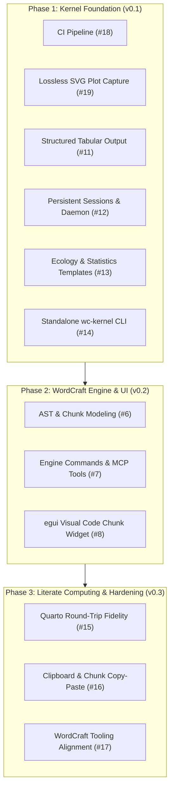

# WordCraft Kernel — Roadmap

This roadmap outlines the development phases, technical milestones, and architectural evolution of `wordcraft-kernel`, the execution engine and persistent session server for interactive code chunks (R and Python) in WordCraft and scientific literate computing (Quarto / R Markdown).

---

## Architecture & Integration Overview

---

## Phase 1: Core Execution Engine & CLI (v0.1.0) — *Current*

Focus: Hardened, sandboxed subprocess runner with multi-format output capture, stateful daemon sessions, and standalone CLI tooling.

- [ ] **Continuous Integration & Quality Gates** ([#18](https://github.com/batistalucasv/wordcraft-kernel/pull/18))
  - Automated CI workflow on GitHub Actions for Rust formatting (`cargo fmt`), strict clippy linter (`-D warnings`), and full test suite.
  - Multi-language test environments for CPython and R runtime setups.
- [ ] **Lossless Vector SVG & Raster Plot Capture** ([#19](https://github.com/batistalucasv/wordcraft-kernel/pull/19), resolves [#1](https://github.com/batistalucasv/wordcraft-kernel/issues/1))
  - Dual graphics hooks in R (`plot.new` and `grid.newpage`) for base R, `ggplot2`, and `lattice`.
  - Python Matplotlib SVG and PNG stream interception.
  - Format selection (`PlotFormat::Png`, `PlotFormat::Svg`, `PlotFormat::Both`) with automatic cleanup of empty plot files.
- [ ] **Structured Tabular Data Extraction** ([#11](https://github.com/batistalucasv/wordcraft-kernel/pull/11), resolves [#2](https://github.com/batistalucasv/wordcraft-kernel/issues/2))
  - Automatic inspection and capture of R `data.frame` (including `anova()` term names) and Python `pandas.DataFrame`.
  - Explicit helper `wc_table()` across both runtimes.
  - Pre-serialization resource limits (16 tables, 10,000 rows, 256 columns, 4,096 chars/cell).
- [ ] **Interactive Persistent Sessions & Daemon Management** ([#12](https://github.com/batistalucasv/wordcraft-kernel/pull/12), resolves [#4](https://github.com/batistalucasv/wordcraft-kernel/issues/4))
  - `SessionManager` managing long-lived child processes per `session_id`.
  - Process tree isolation, dedicated IPC protocols, and user stream redirection.
  - Configurable idle session expiry and automated reaping.
- [ ] **Curated Snippet & Template Catalog** ([#13](https://github.com/batistalucasv/wordcraft-kernel/pull/13), resolves [#5](https://github.com/batistalucasv/wordcraft-kernel/issues/5))
  - Parametric statistics and ecology templates for R (`vegan`, `ggplot2`) and Python (`scipy`, `seaborn`).
  - Strict placeholder validation and verbatim source substitution.
  - Scratch workspace RAII drop guard with Unix `0700` restricted permissions.
- [ ] **Standalone `wc-kernel` CLI Executable** ([#14](https://github.com/batistalucasv/wordcraft-kernel/pull/14), resolves [#3](https://github.com/batistalucasv/wordcraft-kernel/issues/3))
  - Terminal-based code evaluation via `-e`, script files via `-f`, or stdin piping.
  - Machine-readable `--json` output serializing full `ExecutionResult`.
  - Direct plot export to disk via `--out-plot`.

---

## Phase 2: WordCraft Engine & UI Integration (v0.2.0)

Focus: Native integration with WordCraft desktop app, engine command dispatch, and desktop UI rendering.

- [ ] **AST & Chunk Data Modeling** ([#6](https://github.com/batistalucasv/wordcraft-kernel/issues/6))
  - Model executable code chunks over `ContentNode` and Pandoc AST.
  - Support chunk options (e.g. `echo`, `eval`, `warning`, `fig.width`, `fig.height`).
- [ ] **Engine Command Dispatch & Execution Orchestration** ([#7](https://github.com/batistalucasv/wordcraft-kernel/issues/7))
  - Implement WordCraft engine commands: `code.run_chunk`, `code.run_all`, `code.restart_session`, `code.interrupt`.
  - Connect WordCraft MCP server tools directly to `wordcraft-kernel`.
- [ ] **Visual Code Chunk Widget (egui)** ([#8](https://github.com/batistalucasv/wordcraft-kernel/issues/8))
  - Embedded desktop code chunk editor with syntax highlighting.
  - Collapsible outputs for stdout, stderr, tabular views, and high-DPI plot displays.
  - Inline execution controls (Run Chunk, Run Below, Clear Output).

---

## Phase 3: Literate Computing & Scientific Interoperability (v0.3.0)

Focus: Round-trip fidelity with Quarto markdown documents and production hardening.

- [ ] **Quarto (.qmd) Document Round-Trip Fidelity** ([#15](https://github.com/batistalucasv/wordcraft-kernel/issues/15))
  - Preserve Quarto-specific syntax, callouts, and frontmatter without rewriting them as raw div fences.
- [ ] **Clipboard & Multiline Paste Resiliency** ([#16](https://github.com/batistalucasv/wordcraft-kernel/issues/16))
  - Handle clipboard synchronization without dropping trailing newlines or corrupting indentation when transferring chunks between WordCraft and external editors.
- [ ] **Ecosystem Tooling Alignment** ([#17](https://github.com/batistalucasv/wordcraft-kernel/issues/17))
  - Align `rustfmt.toml` and formatting conventions with upstream WordCraft standards.

---

## Technical Directives & Quality Standards

1. **Panic-free Rust:** `#![deny(clippy::unwrap_used, clippy::expect_used, clippy::panic, clippy::unimplemented, clippy::todo, clippy::unreachable)]` and `#![forbid(unsafe_code)]`.
2. **Subprocess Resilience:** Strict timeout enforcement, process group reclamation, and zero process/descriptor leaks.
3. **Defense in Depth:** Input validation, memory-bounded deserialization, and strict owner-only scratch directories (`0700`).
4. **Test Coverage:** All bug fixes and features require automated regression tests with strict assertions (no silent skip-on-None patterns).
