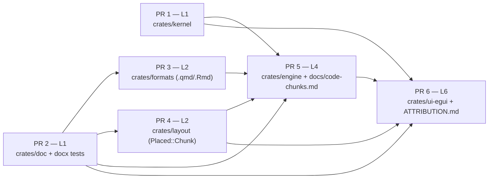

# Upstream Layered PR Plan (`storytold/wordcraft`)

This directory holds the ready-to-use pull request blueprints for submitting the Code Chunks stack from `batistalucasv/wordcraft:main` to upstream `storytold/wordcraft:main` as **6 clean, single-commit, strictly layered PRs** (**PR 1** through **PR 6**).

All 29 post-PR #49 hardening and bug-fix issues (`#72` and `#73`–`#100`, tracked in [`batistalucasv/wordcraft#101`](https://github.com/batistalucasv/wordcraft/issues/101)) are resolved and consolidated into this 6-PR plan (tracked in [`batistalucasv/wordcraft-kernel#25`](https://github.com/batistalucasv/wordcraft-kernel/issues/25)).

---

## Dependency Graph

- **Parallel Wave A (no prerequisites):** PR 1 and PR 2 can be opened and reviewed in parallel.
- **Parallel Wave B (after PR 2 merges):** PR 3 and PR 4 can be opened and reviewed in parallel.
- **Wave C (after PR 1, PR 2, PR 3, and PR 4 merge):** PR 5 lands the full engine command & I/O layer without needing any later rework in `crates/engine`.
- **Wave D (after PR 5 merges):** PR 6 lands the pure L6 UI widget, canvas mounting, ribbon, context menu, and file dialogs (zero L2 changes, zero `apps/` changes).

---

## 6-PR Summary Matrix (78 Files Total)

| PR | Layer | Primary Crate(s) | Branch Name | Files | Depends On | Blueprint |
|---|---|---|---|---:|---|---|
| **PR 1** | **L1** | `crates/kernel` | `feat/upstream-pr1-kernel` | 8 | None | [pr-1-kernel.md](pr-1-kernel.md) |
| **PR 2** | **L1** | `crates/doc` (+ `crates/docx` tests) | `feat/upstream-pr2-doc-chunks` | 5 | None | [pr-2-doc.md](pr-2-doc.md) |
| **PR 3** | **L2** | `crates/formats` | `feat/upstream-pr3-quarto-formats` | 3 | PR 2 | [pr-3-formats.md](pr-3-formats.md) |
| **PR 4** | **L2** | `crates/layout` (+ 1-line workspace match shims) | `feat/upstream-pr4-layout-chunks` | 13 | PR 2 | [pr-4-layout.md](pr-4-layout.md) |
| **PR 5** | **L4** | `crates/engine` (+ `docs/code-chunks.md`) | `feat/upstream-pr5-engine-code` | 20 | PR 1, PR 2, PR 3, PR 4 | [pr-5-engine.md](pr-5-engine.md) |
| **PR 6** | **L6** | `crates/ui-egui` (+ `ATTRIBUTION.md`) | `feat/upstream-pr6-ui-code-chunks` | 29 | PR 1, PR 2, PR 4, PR 5 | [pr-6-ui-egui.md](pr-6-ui-egui.md) |

> **Follow-up PR (out of initial 6-PR wave):**
> - Vendoring `SessionManager` (`persistentSessions: true` daemon sessions from `wordcraft-kernel#4` / PR #12) into `crates/kernel` and `crates/engine` can follow cleanly once PR 1–PR 6 land.

---

## Pre-Submission Checklist (Every PR)

Before opening each PR against `storytold/wordcraft:main`:

1. Sync fork `main` with `upstream/main` and branch cleanly from `upstream/main` (or the prerequisite PR branch once merged).
2. Keep each PR to **one clean squashed commit** containing only the files listed in its blueprint.
3. Run all local gates for the touched crates:
   - `cargo fmt --all -- --check`
   - `cargo clippy -p <changed-crates> --all-targets -- -D warnings`
   - `cargo test -p <changed-crates>` (include `-p wordcraft` when testing `wordcraft-ui-egui`)
   - `cargo xtask layers`
   - `cargo xtask wasm`
   - `cargo xtask assets` (PR 6, which adds `crates/ui-egui/icons/codeChunk.svg` and updates `ATTRIBUTION.md`)
4. Validate on fork CI (`batistalucasv/wordcraft`) before opening on `storytold/wordcraft`.
5. Keep PR titles, commits, and descriptions free of agent attribution, and report only checks that actually ran.
