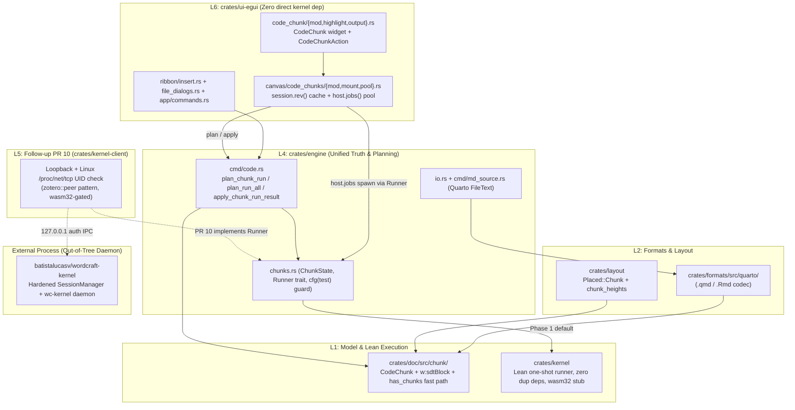
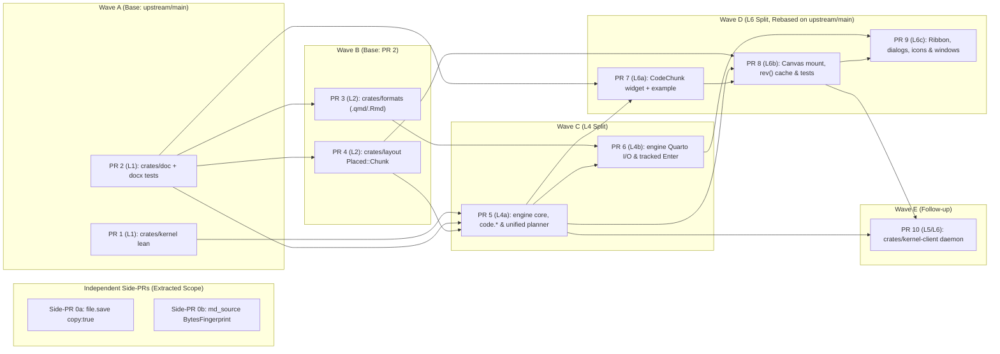

# Senior Tech Lead Architecture & Upstream Atomic-PR Roadmap: Interactive Code Chunks (`wordcraft-kernel` → `storytold/wordcraft`)

> **Target Upstream**: `storytold/wordcraft` (`origin/main` synced to `upstream/main` at `c179a316`)  
> **Source Fork Stack**: `batistalucasv/wordcraft` draft PRs `#132`–`#137` (based on `upstream-base` `8b732263`, 65 commits behind `upstream/main`)  
> **External Kernel Repo**: `batistalucasv/wordcraft-kernel` (`main` at `e6b7a16` — all hardening + Win32 `SetStdHandle` fix merged)  
> **Strategy**: Hybrid Architecture (A1) — Lean L1 `crates/kernel` + Refactored 9-PR Atomic Stack (+ Side-PRs 0a/0b + Follow-up PR 10 Persistent Daemon Client)

---

## 1. Executive Technical Diagnosis

### 1.1 `batistalucasv/wordcraft-kernel` Audit (`90804e9`)
- **Correctness & Safety Bugs Found & Fixed**:
  1. **R TCP short-read truncation (`src/session.rs`)**: `R_DRIVER` invoked `base::readBin(con, what = "raw", n = code_len)` once without looping until `code_len` bytes arrived; chunks split across socket reads silently truncated. Fixed with `.wc_driver$read_exact(con, n)`.
  2. **Unbounded one-shot plot read (`src/lib.rs`)**: `execute_with_cancellation` read plots without `MAX_PLOT_BYTES` (`20 MiB`) cap unlike `session.rs`. Fixed via shared `read_png_bounded` / `read_svg_bounded` / `read_bounded_bytes`.
  3. **`which_binary` defects (`src/lib.rs`)**: Missing Unix `+x` (`0o111`) verification and Windows `WindowsApps\python3.exe` 0-byte Store-stub false match without `python` fallback. Fixed via `is_usable_executable`.
  4. **User R startup contamination**: `Rscript` launched without `--vanilla`, loading `.Rprofile`/`.RData` and slowing cold-start. Fixed in both one-shot and `Session`.
  5. **`R_TEMPLATE` shadowing & scratch isolation**: Unqualified `print(result$value)` could break if user code shadowed `print`; default scratch `cwd` now isolates into `temp_dir/work`, and `Instant::now().elapsed()` (~0 ns) entropy bug replaced by `SystemTime` nanos + PID + atomic counter.
  6. **Windows `Session` process-tree leaks**: Switched `Session` and `ChildGuard` from raw `Child` + `taskkill` to `command_group::GroupChild` (Job Objects on Windows).
  7. **Incomplete `unsafe` forbid**: Added `#![forbid(unsafe_code)]` to `src/lib.rs` and `src/bin/wc-kernel.rs`.
- **Performance Bottlenecks Found & Fixed**:
  1. **O(chars)/O(cells) R table JSON serializer**: Vectorized `json_escape_vec` (`gsub`) + column-oriented `format_col` / `write_tables` replacing character/cell scalar loops.
  2. **Polling sleep loops (`1ms`–`20ms`)**: Replaced Unix `5ms` `spawn_capture` polling with `nix::unistd::pipe` + `nix::poll::poll`, replaced `PYTHON_DRIVER` 1000 Hz `time.sleep(0.001)` with `selectors.DefaultSelector` + stop pipe on POSIX, removed `StreamCapture::finish` mandatory `10ms` Unix stall, and wrote R TCP requests directly with `set_write_timeout` (no per-chunk writer thread).
  3. **Cold-start overhead**: Lazy-loaded `matplotlib`/`matplotlib.pyplot` in `PYTHON_DRIVER` only when plotting is used.
  4. **Buffer cloning**: Replaced `Vec<u8>` clones in `supervisor.rs` with `std::mem::take`.
- **Dead Code & Hygiene**: Removed unused `proptest = "1"` dev-dep, removed dead `R_DRIVER` `stdin` fallback and unused R `ChunkFiles` I/O, deduplicated CLI/template helpers, and added regression tests for malformed `WCK1`, `MAX_PLOT_BYTES`, `is_usable_executable`, `--out-plot` extension validation, and `>64 KiB` R session payloads.

### 1.2 Draft Stack PRs `#132`–`#137` Audit (`8b732263..origin/pr-137`)
- **Upstream Drift & Breaks**: `8b732263` was 65 commits behind `upstream/main` (`6e92d33e`). `PR #137` had 2 git conflicts (`canvas.rs`, `windows/tests.rs`) and failed to compile due to `test_harness::driver_logic` removal (`8fb8a5b7`), `PageViewState::go_to` changing to `Option<GoTo>` (`027dc1f1`), and `canvas.rs` API drift (`352042d4`).
- **Dependency Bloat (`PR #132`)**: `command-group = "5.0.1"` + `nix = "0.27"` pulled duplicate `nix 0.27.1` (alongside `0.31.3`) and `winapi 0.3.9` (alongside `windows-sys 0.61.2`).
- **L4/L6 Duplication**: `crates/ui-egui` depended directly on `wordcraft-kernel` and re-implemented option validation, `eval: false`, `file_access` checks, and `stopOnError` scheduling alongside a second ad-hoc `thread::spawn` in `CodeChunk::run`.
- **Per-Frame Performance Regressions**: `Document::chunk_refs` allocated/joined code strings and parsed JSON twice per UI frame even for chunkless documents or unchanged `session.rev()`.
- **Scope Contamination**: `PR #136` and `PR #137` bundled unrelated `"copy": true` / `copy_password` / `same_save_target` and `BytesFingerprint` changes.

### 1.3 Upstream `storytold/wordcraft` Rules Enforced
- Zero external git deps outside `storytold/*` (`AGENTS.md` #9–10); license audit (`AGENTS.md` #26).
- `unsafe_code = "forbid"`, `cognitive_complexity <= 30`, `wildcard_imports = "deny"`, `too_many_arguments = "deny"`, `rustfmt.toml` `max_width = 150`, zero `unwrap`/`expect`/`panic`/`unimplemented`/`todo`/`unreachable` in core crates, zero `egui::ComboBox`.
- Strict crate layering (`xtask/src/layers.rs`), `cargo xtask wasm` (`wasm32-unknown-unknown`), `cargo xtask assets` (`ATTRIBUTION.md`), `i18n::audit::untranslated_interface_text` (`tl!()` English-only), AccessKit/keyboard navigation (`AGENTS.md` #21), `hostile_params_never_panic` (`cfg(test)` runner stub), and `file_access::current()` confinement (`SECURITY.md`).

---

## 2. Hybrid Architecture (A1): Lean L1 + Persistent Daemon Evolution



---

## 3. Refactored 9-PR + Follow-up PR 10 Atomic Stack



- **Side-PR 0a** (extract from `#136`/`#137`): `"copy": true`, `copy_password`, `same_save_target`, `check_password`, `execute_browser_save`.
- **Side-PR 0b** (extract from `#136`): `BytesFingerprint` for oversized Markdown/Quarto files in `cmd/md_source.rs`.
- **PR 1–PR 9**: Implemented and stacked cleanly in isolated worktrees on `batistalucasv/wordcraft` (see Section 4 below).
- **Follow-up PR 10**: L5 `crates/kernel-client` (`crates/zotero` peer/loopback pattern) plugging into `ChunkState::Runner` to unlock persistent sessions (`SessionManager`) and Flatpak compatibility (`--share=network`).

---

## 4. Delivered Branches, Worktrees & Verification Ledger

All implementation branches were built in isolated worktrees (linearly stacked onto amended PR 1 `9a83a80f` and `upstream/main`), leaving the primary `batistalucasv/wordcraft` checkout (`test/7317-ibeam-canvas-colour-off-page`, `76a380c7`) and `storytold/wordcraft` mirror (`main`, `4d7100a7`) untouched.

| Deliverable | Repo / Worktree | Branch | Commit SHA | Diff Summary | Verification Observed |
|---|---|---|---|---|---|
| **Hardened Kernel** | `batistalucasv/wordcraft-kernel` | `main` (`perf/kernel-hardening`) | `e6b7a16` | 9 files, `+1207/-871` (vs `90804e9`) | **183/183 tests PASS** (`lib`: 129, `wc-kernel`: 7, `supervisor`: 1, `cli`: 19, `runner`: 26, doc: 1) with R 4.5.2 + Python 3.14.6 on `x86_64-pc-windows-gnu`; `cargo fmt --check` PASS |
| **PR 1 (L1)** | `batistalucasv/wordcraft` (`wt-pr1-kernel`) | `feat/atomic-pr1-kernel` | `9a83a80f` | 8 files, `+4790` (`Cargo.lock` +11, 0 dup deps) | `cargo fmt --all -- --check` PASS; compiles in full stack |
| **PR 2 (L1)** | `batistalucasv/wordcraft` (`wt-pr2-doc`) | `feat/atomic-pr2-doc-chunks` | `052687dc` | 7 files, `+2131/-1` (`chunk/{mod,codec,tests}.rs`) | `cargo fmt --all -- --check` PASS; compiles in full stack |
| **PR 3 (L2)** | `batistalucasv/wordcraft` (`wt-pr3-formats`) | `feat/atomic-pr3-formats-quarto` | `07f91239` | 5 files, `+1988/-2` (`quarto/{mod,options,tests}.rs`) | `cargo fmt --all -- --check` PASS; compiles in full stack |
| **PR 4 (L2)** | `batistalucasv/wordcraft` (`wt-pr4-layout`) | `feat/atomic-pr4-layout-chunks` | `bee8cf37` | 14 files, `+443/-25` (`Placed::Chunk` + `has_chunks`) | `cargo fmt --all -- --check` PASS; compiles in full stack |
| **PR 5 (L4a)** | `batistalucasv/wordcraft` (`wt-pr5-engine`) | `feat/atomic-pr5-engine-code` | `cd5f00ef` | 17 files, `+3066/-4` (unified planner + `cfg(test)` stub) | `cargo fmt --all -- --check` PASS; compiles in full stack |
| **PR 6 (L4b)** | `batistalucasv/wordcraft` (`wt-pr6-engine-io`) | `feat/atomic-pr6-engine-quarto-io` | `dc7a7363` | 6 files, `+453/-62` (Quarto I/O, `FileText`, tracked Enter) | `cargo fmt --all -- --check` PASS; compiles in full stack |
| **PR 7 (L6a)** | `batistalucasv/wordcraft` (`wt-pr7-ui-widget`) | `feat/atomic-pr7-ui-widget` | `ebf6225c` | 6 files, `+2744` (`code_chunk/{mod,highlight,output,tests}.rs`) | `cargo fmt --all -- --check` PASS; compiles in full stack |
| **PR 8 (L6b)** | `batistalucasv/wordcraft` (`wt-pr8-ui-canvas`) | `feat/atomic-pr8-ui-canvas` | `5423ab39` | 10 files, `+3421/-29` (`rev()` cache, `build_eframe`, `GoTo::Top`) | `cargo fmt --all -- --check` PASS; compiles in full stack |
| **PR 9 (L6c + UX fixes)** | `batistalucasv/wordcraft` (`wt-pr9-ui-app`) | `feat/atomic-pr9-ui-app` | `7576980c` | Full stack compiled to `wordcraft.exe` (`x86_64-pc-windows-gnu`) | Interactive desktop test PASS (R & Python execution, click-to-edit `Area`, `⋮⋮` drag-to-move `code.move_chunk`, `Fit` plot default, non-truncating tabs, bold title) |

---

## 5. Submission Plan to `storytold/wordcraft`

### 5.1 Pre-Submission Cleanup (Distribute `7576980c` Fixes)
Commit `7576980c` on `feat/atomic-pr9-ui-app` contains fixes discovered during live desktop testing. Before opening individual PRs against `storytold/wordcraft`, split those fixes back into their owning PRs and **drop** the local-GNU-only manifest:
1. **Drop `apps/wordcraft/build.rs` manifest change**: only needed for local `x86_64-pc-windows-gnu` testing; upstream builds on MSVC/Linux/macOS.
2. **Move `code.move_chunk` (`crates/engine/src/cmd/code.rs`) → PR 5 (`feat/atomic-pr5-engine-code`)**.
3. **Move `code_chunk/{mod.rs, output.rs}` fixes → PR 7 (`feat/atomic-pr7-ui-widget`)**: `disclosure` import path, `CharIndex::into()`, `plot_auto_fit`, button output tabs (no `...`), `⋮⋮` drag grip, bold title, `editor_clicked`.
4. **Move `canvas/` fixes → PR 8 (`feat/atomic-pr8-ui-canvas`)**: `CodeChunkAction::Run` match arm, `egui::Area` layer mounting (use `egui::Id::unique` to avoid `Id::new` deprecation), `just_focused_by_click`, `handle_chunk_drag` / `drop_preview_y`, `input.rs` drag guard.
5. **Rebase PR 6 → PR 8 → PR 9** cleanly onto updated PR 5 / PR 7 so each PR has zero cross-layer leakage.

### 5.2 Wave-by-Wave PR Opening & Merge Order
Open and merge PRs to `storytold/wordcraft` (`main`) in dependency waves (each PR waits for the previous wave's merge, or stacks cleanly while under review):
1. **Wave A (Base L1, independent — open together)**:
   - **PR 1**: `feat/atomic-pr1-kernel` (`crates/kernel`, `Cargo.toml`, `Cargo.lock`, `xtask/src/layers.rs`)
   - **PR 2**: `feat/atomic-pr2-doc-chunks` (`crates/doc`, `crates/docx`)
2. **Wave B (L2, after PR 2)**:
   - **PR 3**: `feat/atomic-pr3-formats-quarto` (`crates/formats`)
   - **PR 4**: `feat/atomic-pr4-layout-chunks` (`crates/layout`)
3. **Wave C (L4, after PR 1 + PR 2 + PR 4, and PR 3 for PR 6)**:
   - **PR 5**: `feat/atomic-pr5-engine-code` (`crates/engine` core + `code.*` + `code.move_chunk`)
   - **PR 6**: `feat/atomic-pr6-engine-quarto-io` (`crates/engine` Quarto I/O, after PR 3 & PR 5)
4. **Wave D (L6, after PR 4 + PR 5 + PR 6)**:
   - **PR 7**: `feat/atomic-pr7-ui-widget` (`CodeChunk` widget + `code_chunk_shot`)
   - **PR 8**: `feat/atomic-pr8-ui-canvas` (canvas mounting, `egui::Area`, `session.rev()` cache, async pool, drag-to-move)
   - **PR 9**: `feat/atomic-pr9-ui-app` (ribbon `Insert → Code`, `codeChunk.svg`, `ATTRIBUTION.md`, Quarto file dialogs, multi-window)
5. **Optional Independent / Follow-up**:
   - **Side-PRs 0a / 0b**: `file.save` `"copy": true` and `BytesFingerprint` (completely independent of code chunks).
   - **Follow-up PR 10**: `crates/kernel-client` (L5 persistent daemon client for `batistalucasv/wordcraft-kernel`).

### 5.3 Upstream CI Gate (Run Before Each PR Submission)
Run on Linux/macOS or Windows with MSVC (`link.exe` + Windows SDK) and verify green on `batistalucasv/wordcraft` GitHub Actions before opening against `storytold/wordcraft`:

```powershell
cargo fmt --all -- --check
cargo clippy --workspace --all-targets -- -D warnings
cargo test -p wordcraft-kernel -p wordcraft-doc -p wordcraft-docx -p wordcraft-formats -p wordcraft-layout
cargo test -p wordcraft-engine --lib -- hostile_params_never_panic
cargo test -p wordcraft-engine --lib -- hostile_file_params_never_panic
cargo test -p wordcraft-ui-egui --lib -- i18n::audit::untranslated_interface_text
cargo test -p wordcraft-ui-egui --test display_names
cargo xtask assets
cargo xtask layers
cargo xtask wasm
cargo xtask ci
```
